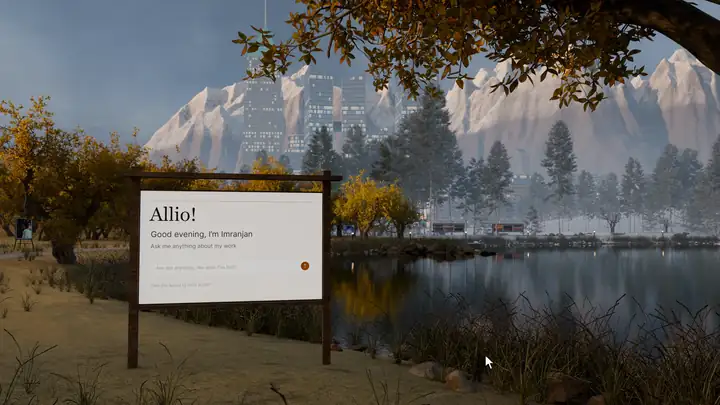

I’m happy to share my laptop with an agent. I’m keeping the mouse.

&nbsp; **[Slipwing](https://github.com/narmi924/slipwing)** lets your agent do the work you’d normally do by hand across Windows apps and Chrome, all in the background.

&nbsp; Give **[Likeness](https://github.com/narmi924/likeness)** a prompt to let your agent build an entire 3D scene in Blender and render it as a film.

&nbsp; You find an old conversation on **[Claude Session Reader](https://github.com/narmi924/claude-session-reader)** by the few words you remember and hand the exact message to your next agent.

&nbsp; Merged upstream in **[agent-browser](https://github.com/vercel-labs/agent-browser)**: `sessionStorage` that survives a login redirect [#2212](https://github.com/vercel-labs/agent-browser/pull/2212), an `errors --clear` that clears [#2253](https://github.com/vercel-labs/agent-browser/pull/2253), HAR exports that retry [#2271](https://github.com/vercel-labs/agent-browser/pull/2271), a Node 22 floor for the package [#2404](https://github.com/vercel-labs/agent-browser/pull/2404).

Also built **[LCIMS Cloud](https://www.imranjan.cn/projects/p-lcims)**, [Gatehouse](https://github.com/narmi924/gatehouse), [PlusOne](https://github.com/narmi924/plusone), [Gantry](https://github.com/narmi924/gantry), [Shopping Copilot](https://github.com/narmi924/shopping-copilot).

Longer stories on [imranjan.cn](https://imranjan.cn).

 
