  <picture>
    <source media="(prefers-color-scheme: dark)" srcset="./assets/profile-header-dark.svg" />
    
  </picture>

<picture>
  <source media="(prefers-color-scheme: dark)" srcset="./assets/contribution-signal-dark.svg" />
  
</picture>

I'm Imran, a developer in Singapore, studying for the [Graduate Diploma in Systems Analysis at NUS-ISS](https://www.iss.nus.edu.sg/graduate-programmes/programme/detail/graduate-diploma-in-systems-analysis) and just wrapping up a full-stack internship at SAP.

I like building things that have to hold up in someone else's hands: agents that check with a person before they act, business software with a lot of rules, and now and then something with a camera or a microphone attached. Most days that means Python and TypeScript.

More at [imranjan.cn](https://imranjan.cn) and on [LinkedIn](https://linkedin.com/in/imranjan7).

 

## Hackathons

- **[Gantry](https://github.com/narmi924/gantry)**, Microsoft × Premier League Inside the Game Hackathon 2026  
  A multi-agent production crew that turns one football match into a separate live broadcast for each kind of fan, from newcomers and analysts to blind fans following an audio-described feed, in eight languages. [Demo video](https://youtu.be/vPupkhUmb2c)  
  `Python`&nbsp;`Microsoft Agent Framework`&nbsp;`Three.js`
- **[PlusOne](https://plusone-sjgp.onrender.com/live/lumicloset)**, PayPal AI Hackathon 2026  
  An assistant for small sellers who sell on live video. Buyers type the way they talk ("the blue one from before, M", "change to L, don't add another"), and it keeps each buyer's order right and collects with PayPal.  
  `TypeScript`&nbsp;`Fastify`&nbsp;`PayPal`
- **[Bring Your Own Factory](https://github.com/narmi924/byof-agent)**, NUS-ISS / AWS Show Me Your Agents Hackathon 2026 with team LIZZ  
  A production-planning agent that reschedules a factory only after the manager approves a plan. [Demo video](https://www.youtube.com/watch?v=Ul6LUf-bLsM)  
  `Python`&nbsp;`LangGraph`&nbsp;`OR-Tools`
- **[Shopping Copilot](https://github.com/narmi924/shopping-copilot)**, TikTok TechJam 2026, Track 4  
  Conversational shopping search that asks back when a request is vague and runs offline without a language model. It found the right product in the top ten for 94% of the 200 public test conversations, against 12.5% for the official baseline.  
  `Python`&nbsp;`FastAPI`&nbsp;`React`

## Projects

- **[LCIMS Cloud](https://lcims.imranjan.me/login)**: real-estate management software rebuilt so several companies share one deployment, each with its own modules, roles and approvals `FastAPI`&nbsp;`Vue`&nbsp;`PostgreSQL`
- **[Look2Act](https://drive.google.com/file/d/12MltCXOCFPti7GvGVxwfDP8TuD26sUZG/view?usp=sharing)**: webcam eye tracking where looking at something long enough clicks it, with a [gaze dataset collector](https://github.com/narmi924/gaze_dataset_collector) and a [demo](https://drive.google.com/file/d/1DjjuPsoB7M3zJUS3Ohix-e2r6DbhTU0c/view?usp=sharing) `PyTorch`&nbsp;`ONNX Runtime`&nbsp;`MediaPipe`
- **[YaQut OA](https://yaqut.imranjan.me/)**: office automation built around approval workflows, with an audit trail `Next.js`&nbsp;`NestJS`&nbsp;`PostgreSQL`
- **[Sound source localisation](https://github.com/narmi924/mengsheng-cup-2024)**: an STM32H7 microphone array that works out where a sound comes from, built for the 2024 Mengsheng Cup `C`&nbsp;`MATLAB`
- **[Yigui](https://github.com/narmi924/YiguiApp)** and its [server](https://github.com/narmi924/yigui-server): an iOS app for designing clothes on a 3D model of your own body and trying them on `Swift`&nbsp;`FastAPI`
- **[AccessAudit](https://github.com/narmi924/AccessAudit)**: a small experiment that records approvals as on-chain events you can verify later `Solidity`&nbsp;`Foundry`

## Open source

[agent-browser](https://github.com/vercel-labs/agent-browser) is how my coding agents open, sign in to and check every web app I build, and I built my own local agent's desktop app on [native](https://github.com/vercel-labs/native). Both are Vercel Labs projects. When either gets in my way, I try to fix it upstream.

<!-- upstream-prs:start -->

- **Saved browser state lost to a login redirect**, agent-browser [#2212](https://github.com/vercel-labs/agent-browser/pull/2212), merged  
  Restoring a saved session seemed to drop large `sessionStorage` values ([#1505](https://github.com/vercel-labs/agent-browser/issues/1505)). I found the size didn't matter: the app's auth guard redirected to login before storage was written, so the value landed under the login page's origin. Carried over from my [#1573](https://github.com/vercel-labs/agent-browser/pull/1573) and [#1574](https://github.com/vercel-labs/agent-browser/pull/1574).
- **`errors --clear` that never cleared**, agent-browser [#2253](https://github.com/vercel-labs/agent-browser/pull/2253), merged with me as co-author  
  The CLI and the MCP server passed the flag on, but the daemon ignored it and kept returning the same errors. Carried over from my [#1654](https://github.com/vercel-labs/agent-browser/pull/1654).
- **HAR captures lost to a failed export**, agent-browser [#2271](https://github.com/vercel-labs/agent-browser/pull/2271), in review with me as co-author  
  `network har stop` cleared the recording before writing the file, so a bad output path lost the capture and a retry saved an empty HAR. Carried over from my [#1590](https://github.com/vercel-labs/agent-browser/pull/1590).

Three more pull requests are open on [agent-browser](https://github.com/vercel-labs/agent-browser/pulls?q=is%3Apr+author%3Anarmi924), for init scripts in new tabs, JSON output for startup errors and CDP sessions that vanish during setup. Four are open on [native](https://github.com/vercel-labs/native/pulls?q=is%3Apr+author%3Anarmi924), mostly to get its build and tests running on Windows.

Recent pull requests

**agent-browser**

- [#1655](https://github.com/vercel-labs/agent-browser/pull/1655) fix(network): ignore vanished CDP sessions during setup (open)
- [#1654](https://github.com/vercel-labs/agent-browser/pull/1654) fix(errors): clear page error log (carried over into [#2253](https://github.com/vercel-labs/agent-browser/pull/2253), merged, co-authored)
- [#1590](https://github.com/vercel-labs/agent-browser/pull/1590) fix(har): preserve capture after export failure (carried over into [#2271](https://github.com/vercel-labs/agent-browser/pull/2271), in review, co-authored)
- [#1576](https://github.com/vercel-labs/agent-browser/pull/1576) fix(cli): preserve JSON for startup errors (open)
- [#1574](https://github.com/vercel-labs/agent-browser/pull/1574) fix(state): restore storage before page scripts (carried over into [#2212](https://github.com/vercel-labs/agent-browser/pull/2212), merged)
- [#1573](https://github.com/vercel-labs/agent-browser/pull/1573) fix(state): report storage restore failures (carried over into [#2212](https://github.com/vercel-labs/agent-browser/pull/2212), merged)
- [#1572](https://github.com/vercel-labs/agent-browser/pull/1572) fix(native): propagate launch init scripts to new targets (open)

**native**

- [#171](https://github.com/vercel-labs/native/pull/171) Make image cache tests compile on Windows (open)
- [#159](https://github.com/vercel-labs/native/pull/159) Use UTF-16 positions in the markup language server (open)
- [#158](https://github.com/vercel-labs/native/pull/158) Run the core package gate on Windows (open)
- [#157](https://github.com/vercel-labs/native/pull/157) Make build validation portable on Windows (open)

<!-- upstream-prs:end -->
