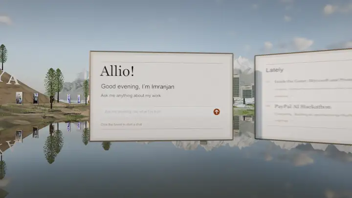

Most of what I build has an agent in it somewhere. When a tool underneath one breaks, I read its source and send a fix upstream.

**Bugs I tracked down in [agent-browser](https://github.com/vercel-labs/agent-browser)**

- Saved sessions losing `sessionStorage` to a login redirect, [#2212](https://github.com/vercel-labs/agent-browser/pull/2212)
- `errors --clear` that never cleared, [#2253](https://github.com/vercel-labs/agent-browser/pull/2253)
- HAR captures lost to a failed export, [#2271](https://github.com/vercel-labs/agent-browser/pull/2271)
- A Node 24 requirement leaking into the published package, [#2404](https://github.com/vercel-labs/agent-browser/pull/2404)

**Building** [Gantry](https://github.com/narmi924/gantry), [Shopping Copilot](https://github.com/narmi924/shopping-copilot), [PlusOne](https://github.com/narmi924/plusone), [LCIMS Cloud](https://lcims.imranjan.me/login)

Longer stories on [imranjan.cn](https://imranjan.cn).

 
